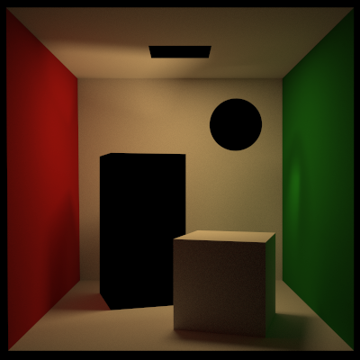
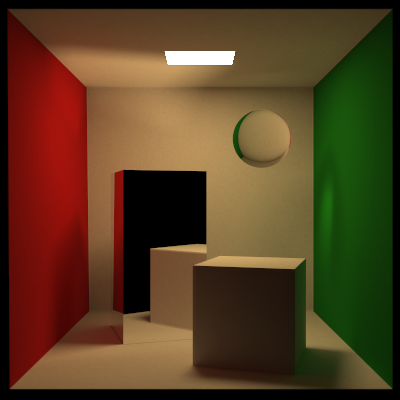
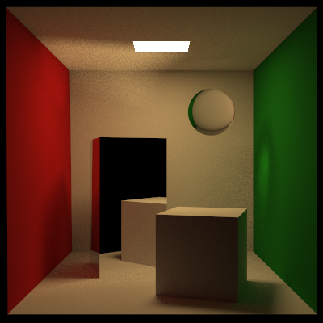
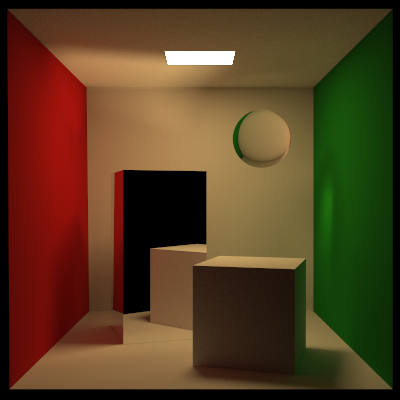

##### Introduction

A photon-mapper implementation following the paper "Global Illumination using Photon Maps" by Henrik Wann Jensen.

The search for the k nearest photons are done using a k-d tree.

##### Dependencies

- C++20
- OpenMP (for parallel processing)

##### Renders

All renders are done in roughly the same time, with a path length of 5 in either direction. Photon-mapping appears more illuminated than path/light tracing. As the path length is not checked when combining paths (it essentially have twice the path length, as is uses both light and path tracing), the number of gathered particles (and hence the largest radius) also affects the apparent illumination.

The sphere is not part of the Cornell Box. It was added to show refracted caustics (the dielectric material does not reflect any rays).

Light trace (4096 samples per pixel). And low importance photon-mapping (1024 spp, 160k global photons, 8 nearest points when gathering).

Path trace (4096 spp and next event estimation). And high importance photon-mapping (1024 spp, 16k global photons, 160k caustic photons, 8 nearest points when gathering, and one ray for final gathering).

